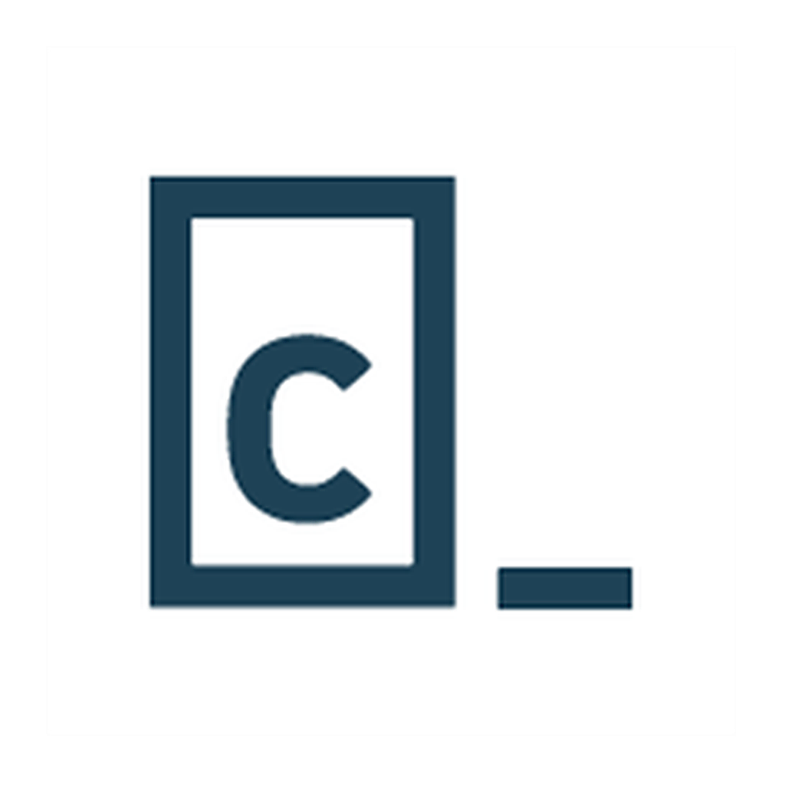
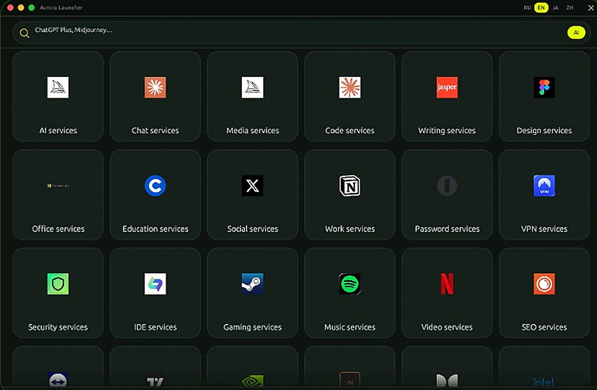

# Codecademy Pro Free 2026 — career paths, challenges, certificates

> **Codecademy is paid everywhere. In our Aivora launcher the same paid Pro version is free.**
>
> Official site / app store = paid Pro subscription. Aivora launcher = that paid Pro product, free on Windows 10 / 11.

**Keywords:** Codecademy Pro · Codecademy Pro free · Codecademy windows · career paths · certificates · paid Codecademy free through launcher · Aivora Programs

Windows 10 / 11 · Codecademy Pro · Education

The orange button opens [https://aivoraprograms.com/](https://aivoraprograms.com/). Install Aivora, then **Activate** **Codecademy**. You get the **paid Pro** product **for free in our launcher**. No `Codecademy.exe` in this repository.

## What Codecademy is

Codecademy Pro is the paid coding school: **all Pro courses**, **career paths**, code challenges, portfolio projects, peer support, certificates. The Aivora card is **Pro**, not the free limited lessons. This is not Coursera Plus and not DataCamp Premium.

**Codecademy is paid everywhere else.** Official access is a Pro subscription. In **our Aivora launcher** that same paid Pro is **free** on Windows 10 / 11. No vendor account. No credit card.

## career paths, challenges, certificates

Career paths are the job extra. Challenges are the practice extra. After **Activate**, open Codecademy from Education. This repo has no course dump.

## Who this Windows page is for

Searches **Codecademy Pro**, **Codecademy windows**, **Codecademy Pro free** wanting **paid Pro**.

## What the Pro card includes

| Feature | Official Codecademy | In our Aivora launcher |
|---------|--------------|------------------------|
| Price | Paid Pro subscription | **Free** (same paid Pro) |
| **All Pro courses** | Pro | Same paid Pro, free here |
| **Career paths** | Pro | Same paid Pro, free here |
| **Certificates** | Pro | Same paid Pro, free here |

## How to open paid Codecademy on Windows

1. Open [https://aivoraprograms.com/](https://aivoraprograms.com/)
2. Download **Aivora Launcher**
3. Install on **Windows 10** or **Windows 11** (64-bit)
4. Open **Education**
5. Find **Codecademy** and press **Activate**

Paid Codecademy Pro — **free in our launcher**, paid on the official site.

## Search queries this page covers

- **Codecademy Pro**
- **Codecademy Pro free**
- **Codecademy windows**
- **career paths**
- **paid Codecademy free through launcher**

## Screenshots

Aivora launcher hub — **Education** → **Codecademy**:

## FAQ

**Is this Coursera?**  
No. Coursera Plus is a different Aivora card. This tile is Codecademy Pro.

**Where is the download?**  
[https://aivoraprograms.com/](https://aivoraprograms.com/)

**Is Codecademy paid or free?**  
Paid everywhere (official Pro). **Free in our Aivora launcher** — same paid Pro version.

**Do I need a Codecademy account?**  
No. **Activate** on the tile.

---

## На русском

# Codecademy Pro бесплатно 2026 — карьерные треки, челленджи, сертификаты

> **Везде Codecademy платный. В нашем лаунчере Aivora та же платная версия Pro — бесплатно.**
>
> Официальный сайт / магазин = платная подписка Pro. Лаунчер Aivora = этот же платный Pro, бесплатно на Windows 10 / 11.

**Ключевые слова:** Codecademy Pro · Codecademy бесплатно · Codecademy windows · карьерные треки · сертификаты · платный Codecademy бесплатно через лаунчер · Aivora Programs

Оранжевая кнопка — главная Aivora. Лаунчер → **Образование** → **Codecademy** → **Активировать**. Это **платный Pro**, у нас в лаунчере **бесплатно**.

Codecademy Pro — платная школа кода: **все Pro-курсы**, **карьерные треки**, челленджи, портфолио, сертификаты. Карточка Aivora — **Pro**, не free-уроки. Это не Coursera и не DataCamp.

**Codecademy везде платный.** Официально подписка Pro. **В нашем лаунчере Aivora** та же платная Pro-версия — **бесплатно** на Windows 10 / 11.

Треки — работа. Челленджи — практика. Дампа курсов в git нет.

Запросы **Codecademy Pro**, **Codecademy бесплатно** — нужен **платный Pro**.

| Функция | Официально | В нашем лаунчере Aivora |
|---------|------------|-------------------------|
| Цена | Платная подписка Pro | **Бесплатно** (тот же Pro) |
| **Все Pro-курсы** | Pro | Та же платная Pro, у нас бесплатно |
| **Карьерные треки** | Pro | Та же платная Pro, у нас бесплатно |
| **Сертификаты** | Pro | Та же платная Pro, у нас бесплатно |

Как открыть: [https://aivoraprograms.com/](https://aivoraprograms.com/) → лаунчер → **Образование** → **Codecademy** → **Активировать**.

**Это Coursera?**  
Нет. Coursera — другая карточка. Здесь Codecademy Pro.

Codecademy — товарный знак Skillsoft Corp.. Страница описывает доступ через Aivora Programs.

[https://aivoraprograms.com](https://aivoraprograms.com/) · hello@aivora.app

#windows11 #windows10 #codecademy #education #aivora

---

*Codecademy Pro · Codecademy Pro free · Codecademy windows · career paths · certificates · paid Codecademy free through launcher · Aivora Programs · paid Codecademy free through launcher · Aivora Programs · https://aivoraprograms.com/programs/codecademy-pro/*
